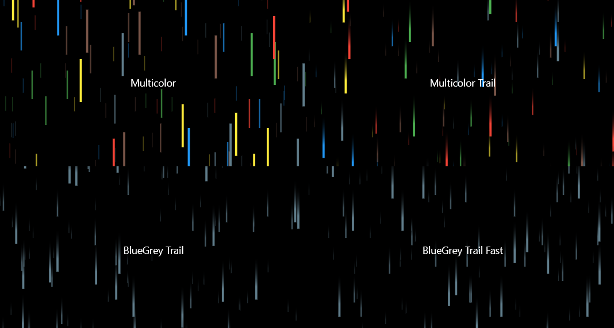
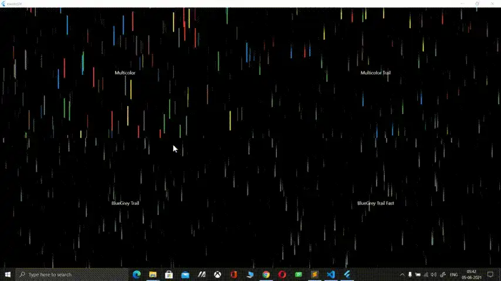

[](https://pub.dev/packages/parallax_rain)
[](https://github.com/Zachariah-Abraham/parallax_rain/actions/workflows/ci.yml)
[](https://opensource.org/licenses/BSD-3-Clause)

# Parallax Rain
Create a cool 3D rain effect, with plenty of customization!





## Installation

```bash
flutter pub add parallax_rain
```

Then import it:

```dart
import 'package:parallax_rain/parallax_rain.dart';
```

## Usage

To give `YourWidget` a 3D rain background, wrap it in a `ParallaxRain` widget. The widget sizes
itself to its child. You can also put the rain in the foreground, use multiple drop colors, adjust
the speed, add trails to the drops and more:

```dart
ParallaxRain(
  dropColors: const [
    Colors.red,
    Colors.green,
    Colors.blue,
    Colors.yellow,
    Colors.brown,
    Colors.blueGrey,
  ],
  trail: true,
  child: const Text('Multicolor'),
),
```

A full example is in the [example](example/lib/main.dart) directory.

### Parameters

| Parameter | Default | Description |
|---|---|---|
| `child` | `null` | The widget shown in the center of the rain. |
| `numberOfDrops` | `200` | Number of drops on screen at any moment. |
| `dropFallSpeed` | `1` | Fall speed in logical pixels per frame at 60 fps. Drops fall at the same speed on displays with other refresh rates. A speed of `0` freezes the rain and stops the animation. |
| `numberOfLayers` | `3` | Number of layers for the parallax effect (at least 1). Drops in nearer layers are bigger, faster and more opaque. |
| `distanceBetweenLayers` | `1` | How much bigger and faster each layer is than the one behind it (greater than 0). |
| `dropHeight` | `20` | Height of a drop in the furthest layer. |
| `dropWidth` | `1` | Width of a drop in the furthest layer. |
| `dropColors` | `[Colors.greenAccent]` | Each drop gets a random color from this list (not empty). |
| `trail` | `false` | Whether drops fade out towards the top. |
| `trailStartFraction` | `0.3` | Fraction of the drop's height, from the bottom, at which the trail starts to fade (0.0 to 1.0). |
| `angle` | `0` | Tilt of the fall direction from straight down, in radians (for example `pi / 12`). Positive angles fall towards the right, negative ones towards the left. Must be between `-pi / 2` and `pi / 2`. |
| `dropShape` | `DropShape.rectangle` | Shape of the drops: `rectangle`, `rounded` (capsule) or `oval` (a circle if width equals height). Works with `trail` and `angle`. |
| `alignment` | `null` | Where the child sits inside the rain area, for example `Alignment.bottomRight`. When set, the rain fills the space its parent allows and the child is aligned in it. |
| `reducedMotion` | `null` | Whether to hold the rain still. `null` follows the device: the rain stops when the system asks for reduced motion (`MediaQueryData.disableAnimations`). `true` always holds it still, `false` always keeps it moving. The drops stay visible where they are. |
| `rainIsInBackground` | `true` | Whether the rain is painted behind (`true`) or in front of (`false`) the child. |

Rebuilding a parent (for example with `setState`) doesn't reset the rain. Parameter changes take
effect when a new `ParallaxRain` is created (for example with a new `key`).

## About me

Visit my LinkedIn at https://www.linkedin.com/in/zaca 

I'm also the author of the Flutter glass package that allows you to convert any flutter widget into a glass/frosted glass version of itself, check it out at https://pub.dev/packages/glass
